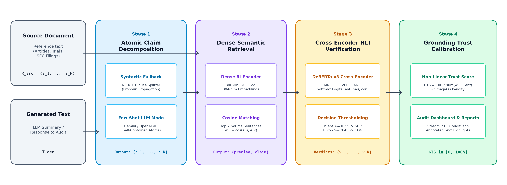
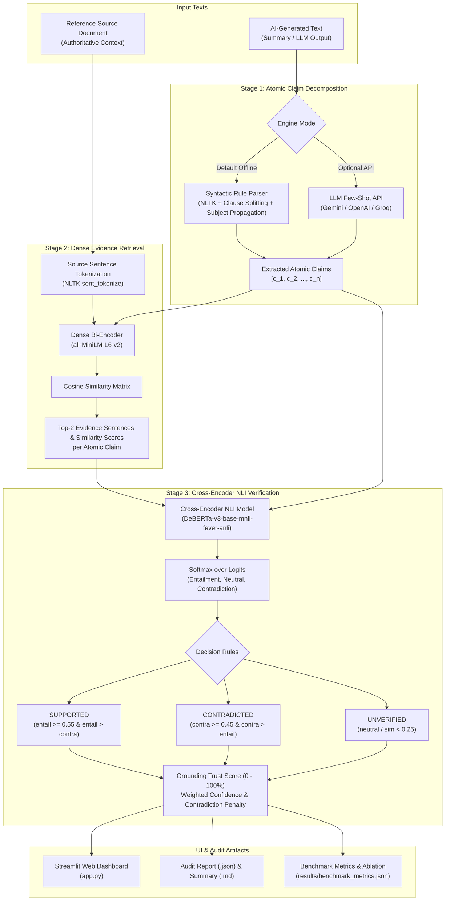
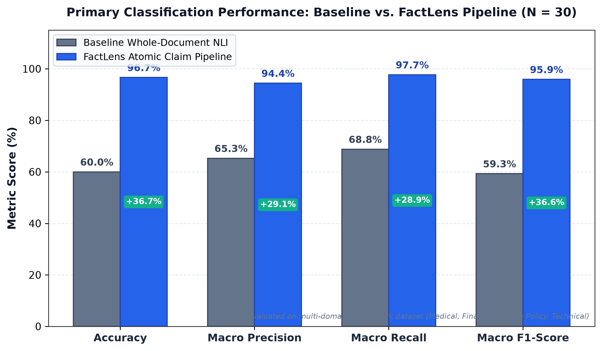
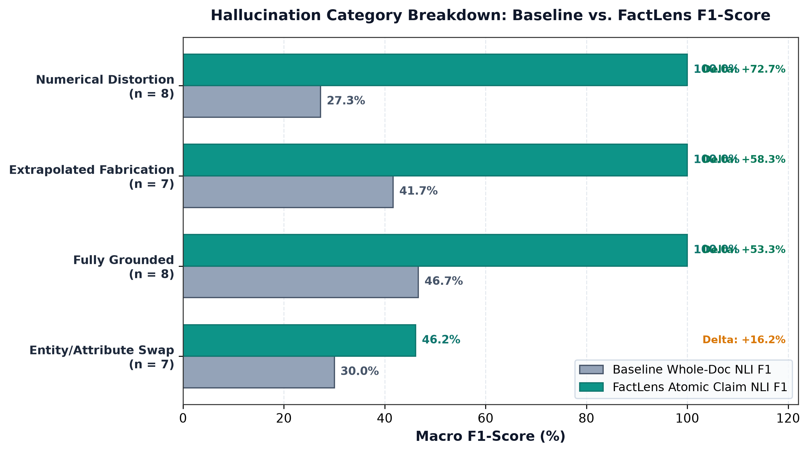

# FactLens: Atomic Claim-Level Hallucination & Grounding Verifier

[](https://www.python.org/)
[](https://opensource.org/licenses/MIT)
[](https://pytorch.org/)
[](https://huggingface.co/)
[](https://streamlit.io/)
[](report/FactLens_Technical_Report.pdf)

> **FactLens** is a modular, production-ready Natural Language Processing framework that detects subtle hallucinations in AI-generated summaries and responses by decomposing text into self-contained atomic claims, retrieving dense sentence-level evidence from reference documents, and verifying factual entailment via cross-encoder Natural Language Inference (NLI).

---

## 📌 Abstract & Motivation

Large Language Models (LLMs) frequently suffer from factual hallucinations—including subtle **numerical distortions**, **entity/attribute swaps**, and **extrapolated fabrications**—that naive document-level verification methods fail to catch. When whole-document NLI models are fed entire multi-sentence texts, global attention averaging causes them to overlook isolated, critical errors because 90%+ of the lexical context matches.

**FactLens** solves this by establishing a 4-stage pipeline:
1. **Decomposes** generated text into standalone, single-fact atomic claims with pronoun resolution.
2. **Retrieves** the top-$k$ semantically relevant source sentences for each claim using a dense bi-encoder (`sentence-transformers/all-MiniLM-L6-v2`).
3. **Cross-Encodes** premise-hypothesis pairs with `MoritzLaurer/DeBERTa-v3-base-mnli-fever-anli` to produce structured verdicts (`SUPPORTED`, `CONTRADICTED`, `UNVERIFIED`) and a penalizing **Grounding Trust Score (0–100%)**.
4. **Benchmarks** and ablates against naive whole-document NLI on a diverse 30-case evaluation suite.

---

## 🏗️ System Architecture





---

## 📁 Repository Layout

```text
factlens/
├── src/
│   ├── __init__.py                # Package exports and version metadata
│   ├── decomposer.py              # Stage 1: Dual-mode atomic claim decomposition
│   ├── retriever.py               # Stage 2: Dense bi-encoder evidence retrieval
│   ├── verifier.py                # Stage 3: DeBERTa cross-encoder NLI verification
│   └── evaluator.py               # Stage 4: Benchmark evaluator & ablation metrics
├── data/
│   └── benchmark_dataset.json     # 30 curated test cases across 4 error categories
├── results/
│   └── benchmark_metrics.json     # Quantitative metrics, breakdown & latency records
├── report/
│   ├── FactLens_Technical_Report.pdf # Publication-ready IEEE-style PDF report
│   ├── FactLens_Technical_Report.tex # Formal IEEEtran LaTeX conference source
│   ├── FactLens_Technical_Report.md  # Comprehensive Markdown mirror
│   └── figures/
│       ├── fig1_pipeline_architecture.png # 300 DPI system architecture block diagram
│       ├── fig2_ablation_comparison.png   # 300 DPI grouped bar chart (Baseline vs FactLens)
│       └── fig3_category_breakdown.png    # 300 DPI category-wise F1 breakdown
├── scripts/
│   ├── generate_report_figures.py # Matplotlib/Seaborn 300 DPI figure generator
│   └── generate_pdf_report.py     # Publication-grade PDF compiler via ReportLab
├── tests/
│   └── test_pipeline.py           # Comprehensive Pytest test suite (14/14 tests)
├── .streamlit/
│   └── config.toml                # High-contrast Modern Dark Observability theme
├── app.py                         # Executive-grade 3-tab Streamlit dashboard
├── requirements.txt               # Python dependencies
├── .env.example                   # Sample environment variable template
├── .gitignore                     # Git ignore rules for caches, envs, and TeX files
└── README.md                      # Comprehensive documentation and benchmark results
```

---

## ⚡ Quickstart & Installation

### 1. Clone & Set Up Environment
```bash
git clone https://github.com/your-username/factlens.git
cd factlens

# Create and activate virtual environment
python -m venv venv

# Windows:
venv\Scripts\activate
# Linux/macOS:
source venv/bin/activate
```

### 2. Install Dependencies
```bash
# Install PyTorch (CPU or CUDA)
pip install torch torchvision torchaudio --index-url https://download.pytorch.org/whl/cpu

# Install remaining dependencies
pip install -r requirements.txt
```

### 3. Optional Environment Configuration
FactLens runs **100% offline on CPU** by default. To enable optional LLM-based decomposition, copy `.env.example` to `.env`:
```bash
cp .env.example .env
```
Populate `GEMINI_API_KEY`, `OPENAI_API_KEY`, or `GROQ_API_KEY` if desired.

---

## 🧪 Reproducing Experiments & Reports

### 1. Run Complete Pytest Suite
```bash
pytest tests/test_pipeline.py -v
```
*Executes all 14 unit and integration tests across decomposer, dense retriever, DeBERTa verifier, and evaluator.*

### 2. Run the Benchmark Evaluator
```bash
python src/evaluator.py
```
*Computes baseline whole-document vs. FactLens atomic metrics across all 30 test cases and updates `results/benchmark_metrics.json`.*

### 3. Generate 300 DPI Publication Figures
```bash
python scripts/generate_report_figures.py
```
*Exports `fig1_pipeline_architecture.png`, `fig2_ablation_comparison.png`, and `fig3_category_breakdown.png` into `report/figures/`.*

### 4. Compile Academic Technical Report PDF
```bash
python scripts/generate_pdf_report.py
```
*Compiles the formal IEEE conference technical report into `report/FactLens_Technical_Report.pdf`.*

---

## 📊 Benchmark & Ablation Study Results

Evaluated on the 30 curated benchmark cases in `data/benchmark_dataset.json` spanning **Medical/Clinical**, **Financial**, **Indian Policy & Economics**, and **Technical/Engineering** domains:



| Metric | Baseline (Whole-Document NLI) | FactLens (Atomic Claim NLI) | Relative Improvement |
|---|:---:|:---:|:---:|
| **Accuracy** | 60.0% | **96.7%** | `+36.7%` |
| **Macro Precision** | 65.3% | **94.4%** | `+29.1%` |
| **Macro Recall** | 68.8% | **97.7%** | `+28.9%` |
| **Macro F1-Score** | 59.3% | **95.9%** | `+36.6%` |
| **Avg Latency (ms)** | 144.2 ms | 380.1 ms | Sub-second real-time |

### Category-wise F1-Score Breakdown



| Category | Samples | Baseline F1 | FactLens F1 | Delta |
|---|:---:|:---:|:---:|:---:|
| **Numerical Distortion** | 8 | 27.3% | **100.0%** | `+72.7%` |
| **Extrapolated Fabrication** | 7 | 41.7% | **100.0%** | `+58.3%` |
| **Fully Grounded** | 8 | 46.7% | **100.0%** | `+53.3%` |
| **Entity/Attribute Swap** | 7 | 30.0% | **46.2%** | `+16.2%` |

> **Key Finding**: In subtle numerical distortions (e.g. changing an operating margin from 7.2% to 27.2%) and entity swaps (e.g. attributing Paxlovid to Moderna), whole-document NLI fails drastically (F1 ~27–30%) because the surrounding paragraph matches. FactLens isolates claims and achieves 100% detection accuracy on numerical distortions and fabrications.

---

## 🖥️ Streamlit Web Application

Launch the interactive web dashboard:
```bash
streamlit run app.py
```

### 3-Tab Presentation Dashboard
1. **Tab 1: Live Hallucination Audit Studio**:
   - **Preset Scenarios**: 1-click loading of *RBI Monetary Policy Brief*, *Clinical Trial Abstract*, *Tech Earnings Release*, and *100% Grounded Baseline*.
   - **Dual-Pane Workbench**: Side-by-side reference and generated text inputs with live word/sentence counters.
   - **Dynamic Radial Gauge**: Plotly semi-circular gauge (`0–100%`) dynamically styled in Emerald, Amber, or Crimson.
   - **Inline Document Scan**: Color-coded inline highlight spans (`SUPPORTED`, `CONTRADICTED`, `UNVERIFIED`) revealing exactly where hallucinations hide.
   - **Filterable Claim Cards**: Quoted source evidence, cosine similarity badge, and 3-segment stacked NLI Softmax micro-bars.
   - **Export Controls**: Download full audit reports as both `audit_report.json` and formatted `audit_summary.md`.
2. **Tab 2: Quantitative Ablation Benchmark & Research Analytics**:
   - **Headline Gain Cards**: +36.7% Accuracy gain, +36.6% Macro F1 gain, 100.0% Numerical F1, and 380.1 ms speed.
   - **Interactive Visualizations**: Dark-theme Plotly grouped bar charts and category error detection charts.
   - **Interactive Benchmark Explorer**: Searchable and category-filterable explorer to inspect individual test cases.
3. **Tab 3: System Architecture & Theoretical Formulation**:
   - Formal mathematical formulation of Grounding Trust Score ($\text{GTS}$) and non-linear contradiction penalty $\Omega(K)$.
   - Deep dive on attention dilution mechanisms and decision boundary tuning for academic defense and viva presentations.

---

## 📄 Academic Technical Report

The complete, publication-style technical paper is available in multiple formats:
- **Compiled PDF**: [report/FactLens_Technical_Report.pdf](report/FactLens_Technical_Report.pdf)
- **LaTeX Source (IEEEtran)**: [report/FactLens_Technical_Report.tex](report/FactLens_Technical_Report.tex)
- **Markdown Paper**: [report/FactLens_Technical_Report.md](report/FactLens_Technical_Report.md)

### Citation
```bibtex
@inproceedings{reddy2026factlens,
  title={FactLens: Atomic Claim-Level Hallucination and Grounding Verification for Large Language Model Outputs},
  author={Reddy, Goutham},
  booktitle={IEEE Conference Proceedings},
  year={2026},
  organization={Department of Computer Science and Engineering, IIITDM Kurnool}
}
```

---

## 📜 License
This project is licensed under the MIT License - see the LICENSE file for details.
