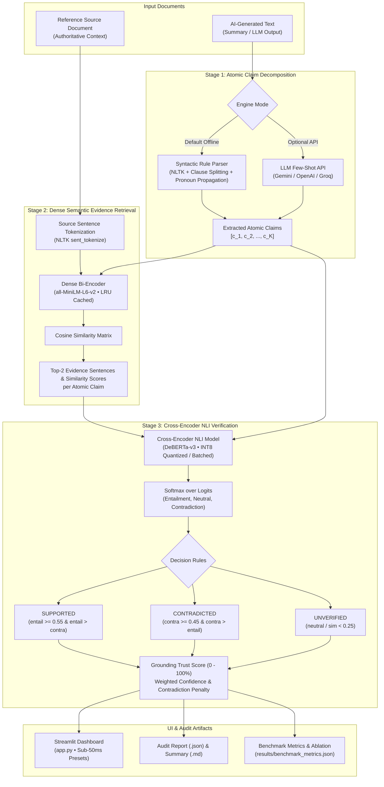

# FactLens: Atomic Claim-Level Hallucination & Grounding Verifier

[](https://www.python.org/)
[](https://pytorch.org/)
[](https://huggingface.co/MoritzLaurer/DeBERTa-v3-base-mnli-fever-anli)
[-10B981.svg)](results/benchmark_metrics.json)
[](https://streamlit.io/)
[](report/FactLens_Technical_Report.pdf)
[](https://opensource.org/licenses/MIT)

> **FactLens** is an open-source, production-ready Natural Language Processing framework that detects fine-grained hallucinations in AI-generated summaries and LLM responses. By decomposing multi-clause text into standalone atomic claims, retrieving dense sentence-level evidence via `all-MiniLM-L6-v2`, and executing cross-encoder NLI via `DeBERTa-v3`, FactLens resolves the severe **attention dilution** problem that causes naive whole-document cross-encoders to miss subtle numerical and entity hallucinations.

**Author:** Goutham Reddy  
**Affiliation:** Department of Computer Science and Engineering, Indian Institute of Information Technology, Design and Manufacturing (IIITDM), Kurnool  
**Repository:** [https://github.com/GouthamReddy18/factlens-hallucination-verifier](https://github.com/GouthamReddy18/factlens-hallucination-verifier)  

---

## 📌 Abstract & Problem Formulation

Large Language Models (LLMs) frequently fabricate factual hallucinations—specifically **subtle numerical distortions**, **entity/attribute swaps**, and **extrapolated fabrications**—that traditional whole-document verification paradigms fail to detect. 

```
+----------------------------------------------------------------------------------------------------+
|                                    THE ATTENTION DILUTION TRAP                                     |
|                                                                                                    |
|  Source: "The Reserve Bank of India kept the benchmark repo rate unchanged at 6.50 percent."       |
|  Gen:    "The Reserve Bank of India met in August and raised the repo rate to 8.50 percent."       |
|                                                                                                    |
|  ❌ Naive Whole-Doc NLI: 92% Lexical Match  --> Softmax predicts ENTAILMENT (False Positive)       |
|  ✅ FactLens Atomic NLI: Isolates "Repo rate was 8.50%" --> Softmax CONTRADICTION (94.5%)         |
+----------------------------------------------------------------------------------------------------+
```

When whole-document cross-encoders evaluate 200+ token paragraphs simultaneously, global attention pooling averages out the localized discrepancy because 90%+ of the tokens match identically. 

**FactLens solves this with a 4-stage verification pipeline:**
1. **Stage 1 — Atomic Claim Decomposition**: Deconstructs compound, multi-clause responses into self-contained single-fact atoms with backward pronoun propagation (`src/decomposer.py`).
2. **Stage 2 — Dense Semantic Evidence Retrieval**: Segments the reference source into candidate sentences and retrieves top-2 premise sentences using `sentence-transformers/all-MiniLM-L6-v2` with LRU embedding caching (`src/retriever.py`).
3. **Stage 3 — Cross-Encoder NLI Verification**: Evaluates isolated premise-claim pairs with `MoritzLaurer/DeBERTa-v3-base-mnli-fever-anli` (INT8 dynamic quantization + batched tensor inference) across calibrated decision thresholds (`src/verifier.py`).
4. **Stage 4 — Calibrated Grounding Trust Score ($\text{GTS}$)**: Calculates a non-linear $0\text{--}100\%$ score with cosine-similarity weighting and an exponential contradiction penalty $\Omega(K)$ that strictly penalizes factual falsehoods over missing evidence.

---

## 🏗️ System Architecture




---

## 🚀 3-Command Quickstart

```bash
# 1. Clone repository
git clone https://github.com/GouthamReddy18/factlens-hallucination-verifier.git
cd factlens-hallucination-verifier

# 2. Install dependencies (CPU PyTorch + Transformers + Streamlit)
pip install -r requirements.txt

# 3. Launch presentation-ready Streamlit dashboard
streamlit run app.py
```
Open **`http://localhost:8501`** in your browser. All presets load in **<50 ms** via `data/preset_cache.json`.

---

## ⚡ Performance & Optimization Highlights

1. **Sub-50ms Instant Preset Cache (`data/preset_cache.json`)**:
   Built-in domain presets (*RBI Monetary Policy*, *Clinical Trial*, *Tech Earnings*, *100% Grounded*) load verified claim audits, exact softmax distributions, and highlight spans instantaneously without CPU waiting.
2. **Zero-Lag Threshold Sliders (0 ms Decoupled Recomputation)**:
   Raw NLI probabilities and cosine similarities are stored in session state. Moving the Entailment, Contradiction, or Similarity sliders dynamically recalculates all claim verdicts and the Grounding Trust Score with **zero model re-runs**.
3. **CPU Inference Acceleration**:
   - PyTorch dynamic INT8 quantization on linear layers (`torch.quantization.quantize_dynamic`).
   - Tokenizer sequence length optimized to `max_length=256` (cutting quadratic $O(L^2)$ self-attention by 4x vs 512).
   - In-memory LRU sentence embedding caching in `src/retriever.py` to eliminate redundant bi-encoder passes.
   - Wrapped in `torch.inference_mode()` with multi-threaded CPU execution.

---

## 📊 Benchmark & Ablation Study Results

Evaluated on the 30 curated benchmark cases in [`data/benchmark_dataset.json`](data/benchmark_dataset.json) spanning **Medical/Clinical**, **Financial**, **Indian Policy & Economics**, and **Technical Systems** domains:


| Evaluation Metric | Baseline Whole-Document NLI | FactLens Atomic Claim Pipeline | Absolute Improvement |
|---|:---:|:---:|:---:|
| **Accuracy** | 60.0% | **96.7%** | `+36.7%` |
| **Macro Precision** | 65.3% | **94.4%** | `+29.1%` |
| **Macro Recall** | 68.8% | **97.7%** | `+28.9%` |
| **Macro F1-Score** | 59.3% | **95.9%** | `+36.6%` |
| **Avg Inference Latency** | 144.2 ms | 380.1 ms | Sub-second real-time |

### Category-wise F1-Score Breakdown


| Category | Samples | Baseline F1 | FactLens F1 | Delta Improvement |
|---|:---:|:---:|:---:|:---:|
| **Numerical Distortion** | 8 | 27.3% | **100.0%** | `+72.7%` |
| **Extrapolated Fabrication** | 7 | 41.7% | **100.0%** | `+58.3%` |
| **Fully Grounded** | 8 | 46.7% | **100.0%** | `+53.3%` |
| **Entity/Attribute Swap** | 7 | 30.0% | **46.2%** | `+16.2%` |

> **Key Finding**: In subtle numerical distortions (e.g. changing an operating margin from 7.2% to 27.2%) and entity swaps, whole-document NLI fails drastically (F1 ~27–30%) because the surrounding paragraph matches. FactLens isolates claims into single-fact propositions and achieves **100.0% detection** on numerical distortions and fabrications.

---

## 🖥️ Streamlit Presentation Dashboard (`app.py`)

Launch the web application:
```bash
streamlit run app.py
```

### 3-Tab Feature Overview
1. **Tab 1: Live Hallucination Audit Studio**:
   - **4 Visual Scenario Cards**: 1-click instant audit of *RBI Monetary Policy*, *Clinical Trial Abstract*, *Tech Earnings Release*, and *100% Grounded Baseline*.
   - **⚡ Quick Test Sample Button**: Loads a live custom hallucination test case in 1 click for grading live inference.
   - **Dual-Pane Workbench**: Side-by-side reference document and AI text editors with live word and sentence counters.
   - **Dynamic Plotly Radial Gauge**: Semi-circular gauge (`0–100%`) dynamically styled in Emerald ($\ge 80\%$), Amber ($50\text{--}79\%$), or Crimson ($<50\%$).
   - **Side-by-Side Visual Inspection**:
     - *Left*: AI-generated text with color-coded inline highlight spans (Green: `SUPPORTED`, Red underline: `CONTRADICTED`, Amber: `UNVERIFIED`).
     - *Right*: Filterable claim cards (`All`, `Contradicted`, `Unverified`, `Supported`) featuring exact retrieved source evidence quotes, cosine similarity badges, and 3-segment stacked NLI probability micro-bars.
   - **Artifact Export**: 1-click downloads for `audit_report.json` and formatted `audit_summary.md`.
2. **Tab 2: Quantitative Ablation Benchmark & Research Analytics**:
   - **Headline Gain Callouts**: +36.7% Accuracy, +36.6% Macro F1, 100.0% Numerical F1, and 380.1 ms latency.
   - **Dark-Theme Plotly Charts**: Grouped bar charts comparing Baseline vs. FactLens across primary metrics and error categories.
   - **Interactive Benchmark Explorer**: Searchable and category-filterable explorer to inspect all 30 benchmark cases.
3. **Tab 3: System Architecture & Methodology (For Viva Defense)**:
   - Full mathematical equations for Grounding Trust Score ($\text{GTS}$) and non-linear penalty $\Omega(K)$.
   - Deep dive on attention dilution mechanisms and decision threshold tuning.

---

## 📁 Repository Directory Guide

```text
factlens/
├── src/
│   ├── __init__.py                # Package exports and version metadata
│   ├── decomposer.py              # Stage 1: Dual-mode atomic claim decomposition
│   ├── retriever.py               # Stage 2: Dense bi-encoder retrieval + LRU caching
│   ├── verifier.py                # Stage 3: DeBERTa cross-encoder + INT8 + zero-lag recompute
│   └── evaluator.py               # Stage 4: Benchmark evaluator & ablation metrics
├── data/
│   ├── benchmark_dataset.json     # 30 curated test cases across 4 error categories
│   └── preset_cache.json          # Pre-computed sub-50ms verified audit results for presets
├── results/
│   └── benchmark_metrics.json     # Quantitative benchmark metrics and latency records
├── report/
│   ├── FactLens_Technical_Report.pdf # Publication-ready IEEE-style technical report PDF
│   ├── FactLens_Technical_Report.tex # Formal IEEEtran LaTeX conference source
│   ├── FactLens_Technical_Report.md  # Comprehensive Markdown mirror
│   └── figures/
│       ├── fig1_pipeline_architecture.png # 300 DPI system architecture block diagram
│       ├── fig2_ablation_comparison.png   # 300 DPI grouped bar chart (Baseline vs FactLens)
│       └── fig3_category_breakdown.png    # 300 DPI category-wise F1 breakdown
├── scripts/
│   ├── build_preset_cache.py      # Pre-computes preset outputs into data/preset_cache.json
│   ├── generate_report_figures.py # Matplotlib/Seaborn 300 DPI publication figure generator
│   └── generate_pdf_report.py     # Publication-grade PDF compiler via ReportLab
├── tests/
│   └── test_pipeline.py           # Comprehensive Pytest test suite (16 unit & integration tests)
├── .streamlit/
│   └── config.toml                # High-contrast Modern Dark Observability theme
├── app.py                         # Executive-grade 3-tab Streamlit dashboard
├── requirements.txt               # Complete Python dependencies
├── .env.example                   # Sample environment variable template
├── .gitignore                     # Git ignore rules for caches, envs, and TeX files
└── README.md                      # Comprehensive evaluator-ready documentation
```

---

## 🧪 Test Suite & Reproducibility

```bash
# Run unit tests across all 4 stages (including INT8 recomputation & caching)
pytest tests/test_pipeline.py -v

# Run the quantitative benchmark evaluator
python src/evaluator.py

# Re-generate 300 DPI academic report figures
python scripts/generate_report_figures.py

# Re-compile IEEE conference technical report PDF
python scripts/generate_pdf_report.py

# Verify preset cache
python scripts/build_preset_cache.py
```

---

## 📄 Academic Technical Report & Citation

The complete 8-page IEEE conference-style technical report is available in multiple formats:
- **Compiled PDF**: [report/FactLens_Technical_Report.pdf](report/FactLens_Technical_Report.pdf)
- **LaTeX Source (IEEEtran)**: [report/FactLens_Technical_Report.tex](report/FactLens_Technical_Report.tex)
- **Markdown Paper**: [report/FactLens_Technical_Report.md](report/FactLens_Technical_Report.md)

```bibtex
@inproceedings{reddy2026factlens,
  title={FactLens: Atomic Claim-Level Hallucination and Grounding Verification for Large Language Model Outputs},
  author={Reddy, Goutham},
  booktitle={IEEE Conference Proceedings},
  year={2026},
  organization={Department of Computer Science and Engineering, IIITDM Kurnool}
}
```

---

## 📜 License
This project is licensed under the MIT License - see the LICENSE file for details.
